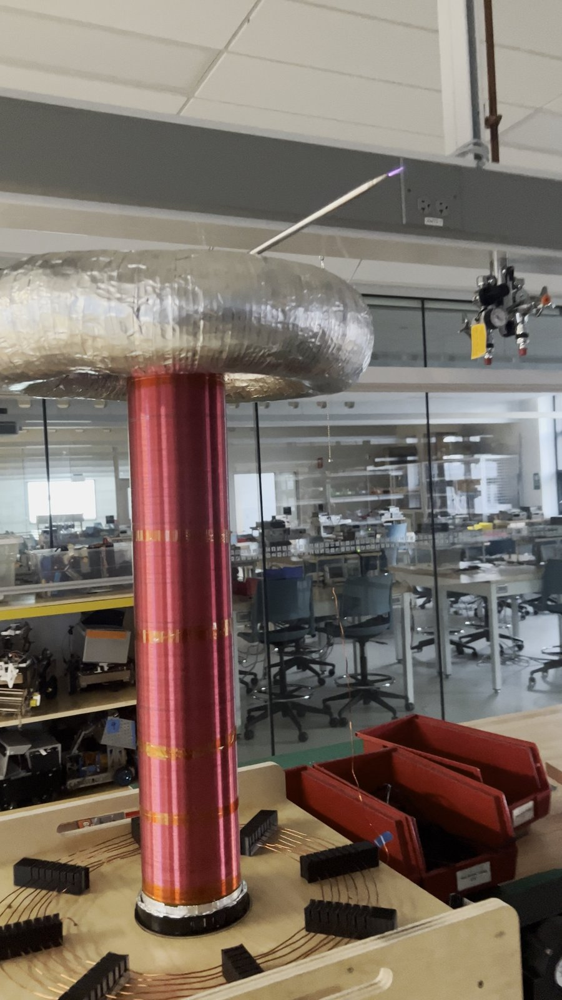
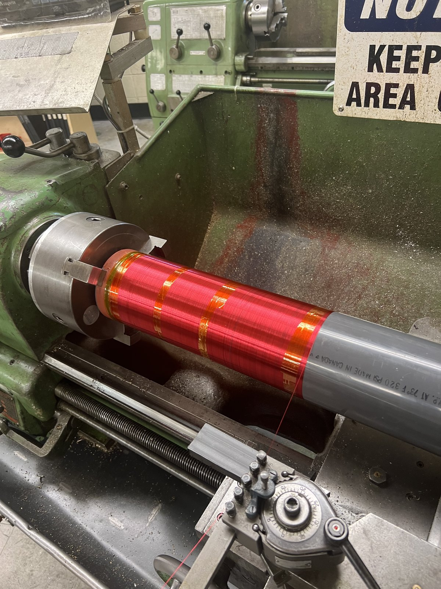
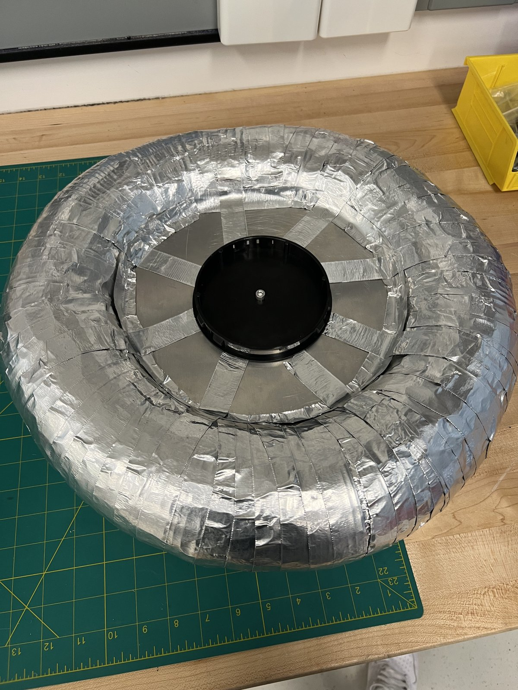
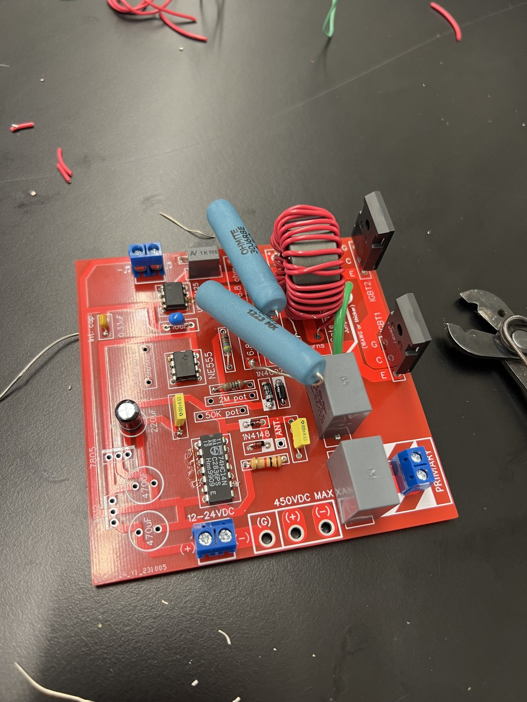
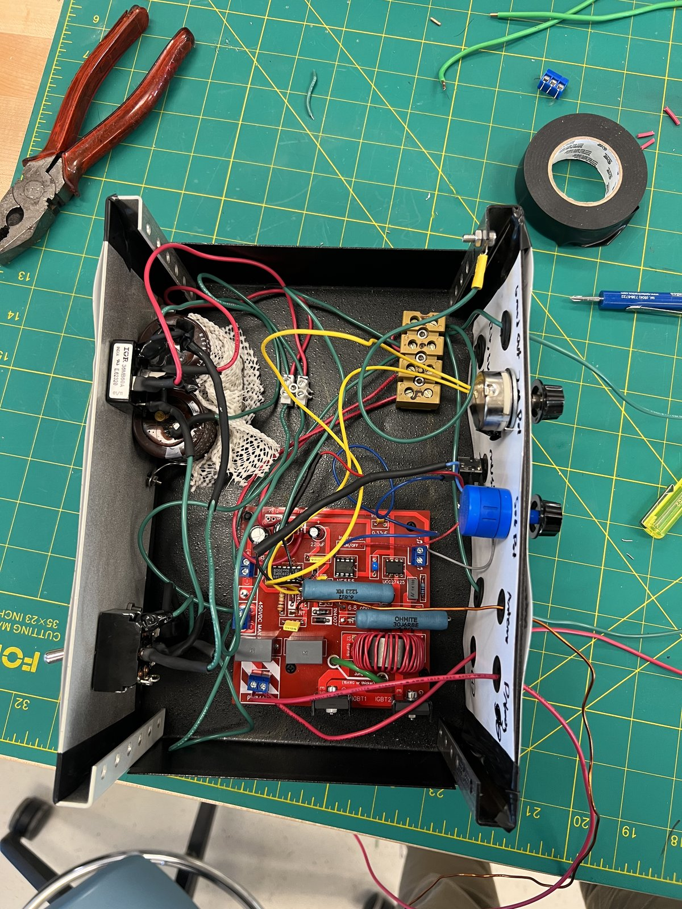
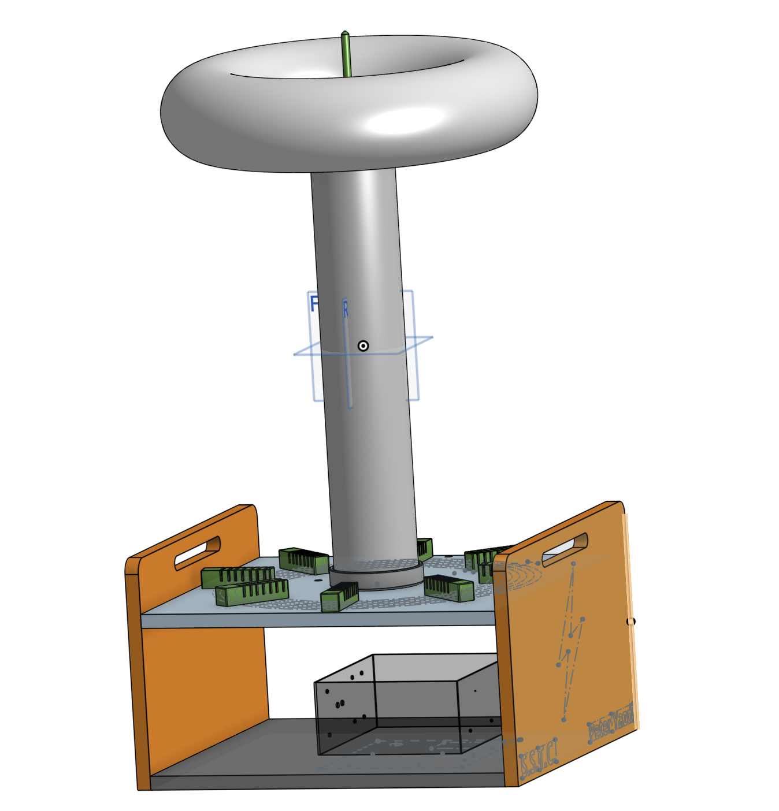
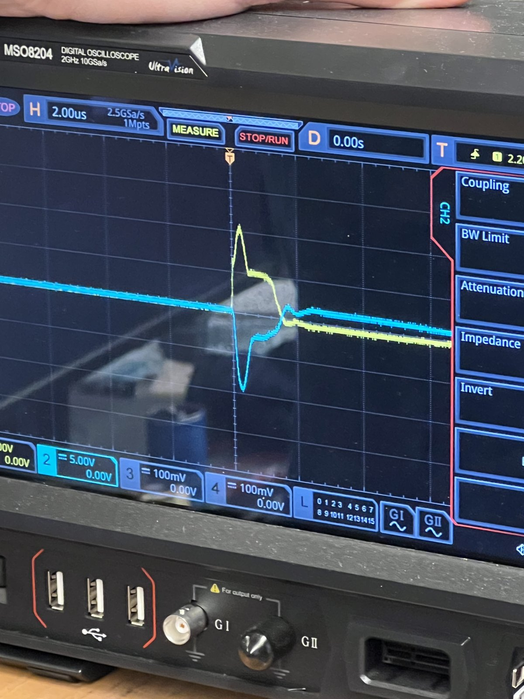
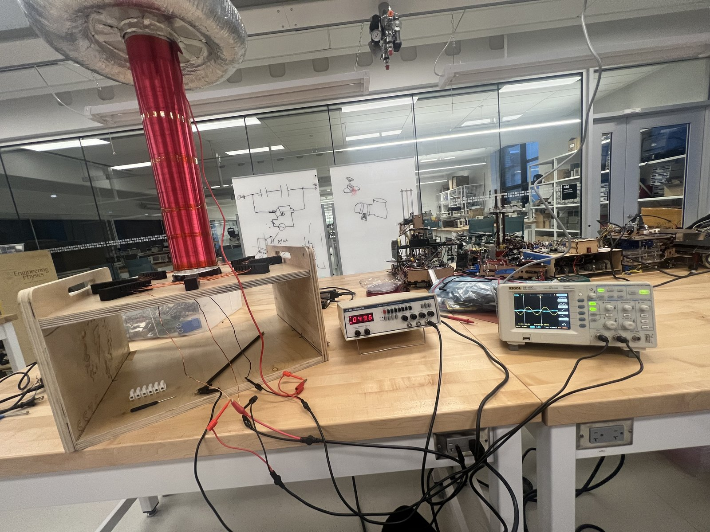

# Solid-State Tesla Coil

A solid-state Tesla coil built for PHYS 420, a project course at UBC, in winter 2023/24. The driver circuit and its PCB are the LabCoatz SSTC 2.0 design (see [Credits](#credits)). I assembled and tested the driver, designed and wound the coil, built the top load, and designed and made the base and enclosure.

<p align="center">
  
  <br>
  <sub>The finished coil running. The thin rod on the top load is the breakout point.</sub>
</p>

A short report on the design, build and results is in [docs/SSTC_Build_Report.pdf](docs/SSTC_Build_Report.pdf).

## How it works

A voltage doubler turns 120 V mains into a DC bus of about 340 V. Two IGBTs in a half bridge switch that bus across the primary coil, a few turns of heavy wire. The secondary coil, about 800 turns of fine wire with the top load on top, is a resonant circuit, and the primary drives it up to a very high voltage.

An antenna near the coil picks up the secondary's oscillation and feeds it back to the gate driver, so the bridge always switches in step with the coil's own resonance and the coil tunes itself. A 555 timer, the interrupter, switches the drive on and off in short bursts, which sets the power and keeps the IGBTs cool. When the electric field at the breakout point passes the breakdown strength of air, about 3 MV/m, the air ionizes and streamers form.

## Hardware

- **Driver:** LabCoatz SSTC 2.0 board with two FGA60N65SMD IGBTs in a half bridge, a UCC27425 gate driver and gate drive transformer, a 74HC14 Schmitt trigger for the antenna feedback, an NE555 interrupter with an adjustable duty cycle, an inrush-limiting thermistor and the voltage doubler. The ICs sit in sockets and the wiring uses screw terminals, so parts can be swapped easily
- **Primary:** 8 to 10 turns of 16 AWG magnet wire on 3D-printed holders
- **Secondary:** about 800 turns of 30 AWG magnet wire over 17 in of a 21 in PVC pipe, wound on a lathe
- **Top load:** a toroid made from 4 in aluminum air duct wrapped in aluminum tape, with a sharpened rod as the breakout point
- **Base and enclosure:** designed in Onshape. Plywood base and side panels cut on a waterjet and laser engraved, with handles. The driver sits in a grounded steel box on a shelf under the coil, away from the top load
- **CAD:** the full assembly and each part as STL files in [mech/](mech/). The 3D-printed primary holder is used 8 times and the side panel twice

<p align="center">
  
  
  <br>
  <sub>Winding the secondary on a lathe (left) and the finished toroid (right).</sub>
</p>

<p align="center">
  
  
  <br>
  <sub>The assembled driver board (left) and the driver wired into its grounded steel box (right).</sub>
</p>

<p align="center">
  
  <br>
  <sub>Onshape model of the coil, base and enclosure.</sub>
</p>

## Specifications

| Specification | Value |
|---|---|
| Type | Solid-state Tesla coil, half bridge, self-resonant |
| Input | 120 V AC mains, voltage doubler to about 340 V DC |
| Switches | 2 × FGA60N65SMD IGBTs |
| Gate drive | UCC27425 through a gate drive transformer |
| Feedback | Antenna into a 74HC14 Schmitt trigger |
| Interrupter | NE555, adjustable duty cycle |
| Primary | 8 to 10 turns, 16 AWG |
| Secondary | About 800 turns, 30 AWG, 17 in winding |
| Top load | Toroid from 4 in aluminum duct |
| Design target | About 300 kHz, sized in JavaTC |
| JavaTC model of the secondary | 381 kHz, 12.8 mH, Q of about 250 |

## Testing and results

The coil was brought up in stages before it ever saw full mains power:

1. Checked the supply pins and every IC with a multimeter.
2. Checked the two gate drive signals on an oscilloscope: opposite in phase, and switched on and off by the interrupter. Turning the interrupter potentiometer changed the duty cycle as expected.
3. Tested the coils on their own by driving the secondary with a function generator and finding its resonance on the oscilloscope.
4. Ran the full coil, first at low power and then at high power.

<p align="center">
  
  
  <br>
  <sub>Gate drive waveforms (left) and the resonance test with a function generator and oscilloscope (right).</sub>
</p>

The coil ran at both power settings, producing streamers from the breakout point and arcs to a grounded rod. I demonstrated it to three Grade 12 physics classes at my former high school. A music mode, which replaces the 555 interrupter with an audio signal, was planned but not finished.

## Repository layout

```
docs/          Build report
docs/images/   Photos and a render of the CAD model
mech/          Full assembly as STL
mech/parts/    Each part as STL
```

## Getting the files

```bash
cd ~/Desktop
git clone https://github.com/peteryazdi/Solid-State-Tesla-Coil.git
```

This works in Terminal on macOS and Linux and in PowerShell on Windows. GitHub shows the STL files in a 3D viewer, and any slicer or CAD tool can open them.

## Safety

This is an educational project. A Tesla coil runs from mains voltage and makes high-voltage, high-frequency output that can cause shocks, burns and fires.

- The bulk capacitors stay charged after the power is off. Use a bleeder resistor and check with a multimeter before touching the driver.
- Ground the driver enclosure, and keep the driver and other electronics away from the top load.
- Stay clear of the discharge while the coil is running. Keep anyone with a pacemaker or other medical implant well away.

## Credits

- The driver circuit and PCB are the LabCoatz SSTC 2.0 by Zach Armstrong ([LabCoatz](https://hackaday.io/project/182391)), based on designs by Steve Ward and Gao Guangyan (Loneoceans) and refined with several other Tesla coil builders.
- The coil dimensions were modeled in JavaTC by Bart Anderson.
- Thanks to Bernhard Zender (Engineering Physics Project Lab) and Mark Carlson (Physics and Astronomy) at UBC for their engineering help.

## License

MIT, for the files in this repository. The LabCoatz circuit and PCB are not part of this repository. See [LICENSE](LICENSE).

## Author

Peter Yazdi, [peteryazdi@gmail.com](mailto:peteryazdi@gmail.com)
